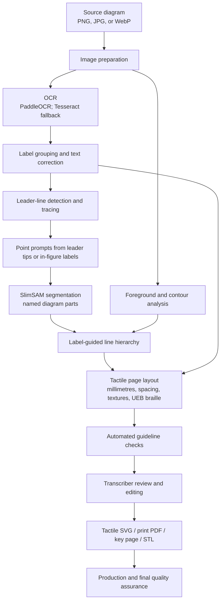

# TouchSight-NG

**A production-oriented drafting tool for tactile graphics transcription.**

TouchSight-NG helps a braille transcriber turn a labeled textbook or instructional diagram into an editable first draft of a tactile graphic. It automates the image-analysis and page-layout work—reading printed labels, tracing the leader lines that identify diagram parts, segmenting those parts, and laying out braille and tactile features—so the transcriber can spend more time reviewing the content and less time building every graphic from scratch.

The transcriber remains responsible for the finished graphic. TouchSight-NG is an assistive production tool, not an autonomous replacement for professional transcription, accessibility review, or testing with tactile readers.

- **Application:** Run locally; the application is not hosted on GitHub Pages.
- **User and technical documentation:** https://mrhunsaker.github.io/touchsight-NG/
- **Getting started:** [docs/getting-started.md](docs/getting-started.md)
- **Theory and pipeline:** [docs/architecture.md](docs/architecture.md), [docs/pipeline.md](docs/pipeline.md)
- **Models and inference engines:** [docs/models-and-engines.md](docs/models-and-engines.md)
- **Advanced, not-yet-implemented AI options:** [docs/advanced-model-options.md](docs/advanced-model-options.md)
- **Review workflow:** [docs/review-workflow.md](docs/review-workflow.md)

## Intended workflow

The primary user is a braille transcriber or teacher of students with visual impairments (TVI) preparing tactile graphics from labeled science, geography, and other instructional diagrams.

A typical job begins with a diagram from a textbook, worksheet, or other instructional source. The application analyzes the diagram and creates a first-draft tactile page. The transcriber reviews the detected wording, part boundaries, braille, spacing, textures, and overall readability; makes corrections in the editor; and exports the result for production and final quality assurance.

The goal is not to automate professional judgment. It is to provide a consistent, standards-informed starting point that a transcriber can inspect, correct, and finish.

## Processing workflow

The image-analysis stages are deliberately ordered. The diagram's labels provide semantic anchors: the system reads the text, follows the leaders to the parts being named, and uses those locations to guide segmentation and tactile rendering. It does not simply convert every visible edge into a raised line.



**Optional Potrace / Autotrace preprocessing** is available to reconstruct a raster before OCR, leader detection, foreground analysis, and segmentation. It does not replace those stages or generate the final tactile page. See [Pipeline stages](docs/pipeline.md).

## What the application produces

- **Tactile graphic:** a page laid out in physical millimetres, with a bold/fine line hierarchy, optional textures, and uncontracted UEB Grade 1 braille.
- **Key page:** a legend for two-letter label keys when full braille labels do not fit.
- **3D relief preview:** a view of the raised lines and braille, plus STL export for 3D printing.
- **Production files:** tactile SVG (pure black, suitable for swell-paper workflows), key page, and print/PDF at true page size.
- **Review information:** detected labels, OCR corrections, leader-line and segmentation overlays, and automated checks alongside a simple edge-tracing baseline.

## Transcriber review is part of the process

The generated page is a draft that must be checked against the source diagram. In particular:

1. Verify every label and its relationship to the correct diagram part.
2. Correct OCR errors and remove labels that should not appear; merge labels split across lines.
3. Inspect leader paths, segmentation boundaries, and the named-part line hierarchy.
4. Check braille placement, clearance, line spacing, texture distinctions, and the key page.
5. Review the 3D relief preview where available, then export and follow the applicable production and quality-assurance process.

See [The transcriber review workflow](docs/review-workflow.md), [Tactile layout and BANA guidelines](docs/guidelines.md), and [Printing and swell paper](docs/printing.md).

## Standards, evaluation, and limitations

Layout and checking are informed by the BANA *Guidelines and Standards for Tactile Graphics* (2022), ICEB *Rules of Unified English Braille*, and Library of Congress Spec 800 braille dimensions. The application uses physical page dimensions and checks including braille clearance, short fragments, and areas where lines are closer than 3 mm.

In an evaluation of 16 Wikimedia Commons diagrams, the current benchmark reported 148 of 151 hand-counted labels found (98%). The evaluation also measured braille placement, short fragments, and close-line areas against an edge-tracing baseline. See [Evaluation and benchmarks](docs/evaluation.md) for the method, per-diagram results, and reproduction instructions.

These measurements are automated checks, not evidence of validated tactile usability. TouchSight-NG has not yet been formally tested with blind readers or systematically validated on physical swell-paper output. Labels are uncontracted UEB. Diagrams without printed labels (or with only math symbols) may receive outlines without named-part labels. OCR can miss text on busy fills; the transcriber can correct detected wording but cannot currently add a label the system failed to detect. Professional review remains necessary.

## Privacy and deployment

TouchSight-NG is a static, browser-based application. OCR, segmentation, layout, checking, rendering, and 3D preview run on the user's device. There is no application backend, account, or image-upload service; source diagrams are not sent to a server. Model and library assets are prepared locally with `npm run vendor`; GitHub Pages publishes documentation only.

This design supports use with school and student materials while keeping source images on the transcriber's computer. See [Architecture](docs/architecture.md) and [Deployment](docs/deployment.md).

## Run locally

Requirements: Node.js 24 or newer.

```bash
npm ci
npm run vendor
npm run serve
```

Open http://localhost:5173 if the local app runtime has been assembled. Note that the current checkout has an incomplete `src/` to `app/` transition: the server and vendor script target `app/`, but the tracked application source is under `src/` and no build/copy step currently populates `app/`. See [Getting started](docs/getting-started.md#asset-path-check) before treating this as a verified clean-checkout setup. To run the automated evaluation harness:

```bash
npm run eval
```

The evaluation harness uses Playwright; install its Chromium browser if it is not already available:

```bash
npx playwright install chromium
```

See [Getting started](docs/getting-started.md) for setup and use, [Models and inference engines](docs/models-and-engines.md) for the model inventory, and [Advanced model options](docs/advanced-model-options.md) for clearly marked research directions.

## Project structure

```
src/                  browser application
  index.html          application shell
  css/                application styles
  js/                 OCR, leaders, segmentation, layout, rendering, UI
  samples/            sample diagrams and source attributions
  precomputed/        precomputed sample outputs
  fonts/              self-hosted fonts
scripts/              vendor build, local server, evaluation and QA tooling
docs/                 user and technical documentation (MkDocs)
.github/workflows/    documentation-only deployment automation
```

Key implementation modules are documented in [docs/modules.md](docs/modules.md). The processing sequence is described in [docs/pipeline.md](docs/pipeline.md).

## Contributing and project maintenance

Contributions are welcome, particularly bug reports and improvements grounded in actual transcription work. Please include a representative source diagram when possible (with permission to share it), describe the expected tactile result, and explain what the current output gets wrong. Changes to OCR, tracing, segmentation, layout, or export should include before-and-after evaluation results where practical.

- [Contributing guide](CONTRIBUTING.md)
- [Code style](CODE_STYLE.md)
- [Code of conduct](CODE_OF_CONDUCT.md)
- [Security policy](SECURITY.md)
- [Change history](CHANGES.md)
- [Documentation contribution guide](docs/contributing.md)

## Credits and licensing

TouchSight-NG builds on open-source OCR, computer-vision, segmentation, and rendering libraries, including PaddleOCR, Tesseract.js, SlimSAM, Transformers.js, ONNX Runtime Web, OpenCV.js, three.js, and Potrace. See the project dependency manifests and relevant upstream projects for their respective licenses.

The application code is licensed under **GPL-3.0-or-later**. Sample diagrams retain their source licenses; attribution is maintained in [src/samples/CREDITS.md](src/samples/CREDITS.md). The precomputed tactile SVGs retain the licenses of their source diagrams.

## Editable SVG post-processing and quality control

The tactile SVG export is a vector document with physical dimensions in millimetres. It contains separate, named SVG groups for the page background, textures, structural line art, outlines, label-clearance knockouts, leader lines, and braille dots. The key-page SVG also separates braille from sighted print-reference text. Paths, circles, and text remain vector objects rather than a flattened screenshot.

**Inkscape is the recommended reference editor because it is free and open-source (FOSS).** The exported SVG is standard vector artwork; other SVG-capable editors—including Adobe Illustrator and Affinity Designer—can also be used. TouchSight-NG targets FOSS workflows, so Inkscape is the editor used in these instructions, not a technical requirement.

Recommended post-processing sequence:

1. Export the editable tactile SVG and, when present, the key-page SVG.
2. Open the SVG in Inkscape. Use the Objects/Layers panel to inspect and isolate the named groups.
3. Compare the artwork with the source diagram and the TouchSight-NG analysis views. Correct path geometry, remove false contours, reconnect broken boundaries, and adjust leader placement where necessary.
4. Check label-to-part correspondence, braille spelling and dot patterns, line hierarchy, texture distinction, clearances, and page margins. Do not assume that a visually attractive edit is tactilely legible.
5. Preserve the physical page dimensions and millimetre scale. Avoid scaling individual objects in ways that alter specified braille or line dimensions.
6. Save a separate reviewed SVG, then produce a physical proof on the target printer/swell-paper/fuser system. Inspect the raised output and obtain tactile-reader feedback where possible.

The vector editor is a post-processing and QC option, not an automated validation step. Editing SVG geometry does not update TouchSight-NG's analysis state or its automated guideline report. Re-run or independently perform checks after edits, and retain the unmodified export so changes can be compared or reverted.
