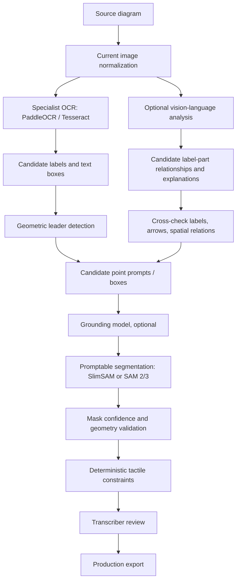

# Advanced model options (research roadmap)

> **Status: research options only. None of the larger models described here is currently integrated into the TouchSight-NG application.** They are candidates for experiments after the existing OCR, leader detection, segmentation, and Potrace work are stable. Adding them would require implementation, browser/runtime compatibility work, licensing review, measured download size, and evaluation on the project's diagram set.

The goal should not be to use the largest model available. It should be to improve a specific failure mode while preserving privacy, predictable tactile geometry, and a workflow that a transcriber can inspect.

## Where larger models could help

Current pipeline components solve narrow tasks:

- OCR reads text and returns boxes.
- Geometric leader detection connects text boxes to line segments.
- SlimSAM turns point prompts into masks.
- Classical image processing extracts boundaries and suppresses noise.

Errors propagate. A missed label means no anchor; a wrong leader tip means a wrong point prompt; a poor mask means a wrong part outline. More capable models could improve individual steps or add a semantic reasoning layer, but they must return structured, spatially grounded results rather than only a prose description.

## Candidate model families

| Candidate | Potential role | Why evaluate it | Main trade-offs |
|---|---|---|---|
| SAM 2 / SAM 2.1 | Higher-capacity promptable segmentation | More capable masks and prompt handling than a tiny distilled segmenter; useful for ambiguous or intricate regions | Larger weights, more memory/compute, more complex runtime integration |
| SAM 3 | Concept- and prompt-conditioned segmentation | Text/concept prompts could help select a named part without relying exclusively on a single point | Newer model/runtime requirements, access and license review, substantial deployment cost |
| Grounding DINO | Open-vocabulary object grounding / bounding boxes | Could take a phrase such as “left ventricle” and propose a region or box before segmentation | It returns boxes, not final tactile-ready masks; specialist diagram terminology may be out of distribution |
| Florence-2 | OCR, captioning, phrase grounding, and visual task prompting | A multi-task vision model could provide a second opinion on text regions and part localization | Must benchmark OCR fidelity and coordinate accuracy; may overlap with existing specialist OCR |
| Qwen3-VL or another vision-language model | Diagram understanding, relation extraction, and verification | Could reason about label-to-part relationships, spatial relations, arrows, and ambiguous diagram structure | Much larger runtime, slower inference, memory requirements, privacy/deployment choices, risk of plausible but ungrounded answers |
| Stronger PaddleOCR / multilingual OCR variants | Text detection and recognition | Could improve small text, skew, multi-language support, and domain-specific OCR | Additional model assets and dictionary/language management; still needs geometric leader association |

Examples and starting points: [SAM 2.1 model family](https://huggingface.co/facebook/sam2.1-hiera-small), [SAM 3](https://huggingface.co/facebook/sam3), [Grounding DINO](https://github.com/IDEA-Research/GroundingDINO), [Florence-2](https://huggingface.co/microsoft/Florence-2-base), and [Qwen3-VL](https://huggingface.co/Qwen/Qwen3-VL-2B-Instruct). Check each model card, license, supported runtime, and current hardware requirements before selecting a checkpoint.

## Proposed hybrid architecture

A practical future architecture would retain deterministic geometric constraints and add larger models only where they provide evidence that improves results.

A model should propose, not silently decide. Every proposed label, box, point, or mask should be stored with its source, confidence, and a visible overlay. Deterministic code should enforce physical spacing, braille geometry, line widths, and page dimensions after AI inference.

## Suggested experiments in order

### 1. Improve segmentation before replacing the whole pipeline

Compare SlimSAM with SAM 2.1 on the same label-derived point prompts. Measure mask overlap against manually reviewed part masks, boundary accuracy, latency, peak memory, and download size. Do not compare models using only their own confidence scores.

### 2. Add phrase grounding as a candidate generator

Test Grounding DINO or Florence-2 with the OCR label text as a phrase prompt. Compare predicted boxes with the existing leader-tip point. The model should supply an alternate candidate, not override a geometrically consistent leader without evidence.

### 3. Add a diagram reasoning pass

Evaluate a vision-language model on questions such as:
- Which visible component does this printed label most likely identify?
- Does the leader line terminate inside that component?
- Are two stacked text lines one label or two?
- Is the label connected by an arrow, bracket, or leader?
- Which diagram regions remain unlabeled?

Require structured output with normalized coordinates and evidence references. Verify all coordinates against the original raster. Do not accept unconstrained narrative as a segmentation annotation.

### 4. Build a transcriber-in-the-loop correction dataset

Capture corrections with permission and appropriate privacy safeguards: corrected OCR, corrected leader endpoints, accepted/rejected masks, and final tactile edits. This creates a defensible basis for later fine-tuning or model selection. Do not assume user edits can be used for training without an explicit data policy.

## Deployment choices

Larger models need not be shipped to every user. Consider three deployment profiles:

1. **Baseline local profile:** current PaddleOCR, Tesseract fallback, SlimSAM, and deterministic processing. Smallest expected footprint and most compatible target.
2. **Enhanced local profile:** optional larger segmentation/grounding models downloaded only when enabled, with a hardware check and clear storage estimate.
3. **Managed inference profile:** optional remote model service for organizations that explicitly configure it. This would change the privacy architecture: source diagrams or crops would leave the device. It must be opt-in, documented, secured, and disabled by default.

A future implementation should not silently download multi-gigabyte weights or route school/student materials to a remote service.

## Evaluation gates for any candidate

A candidate should be adopted only if it demonstrates a measurable improvement on representative labeled diagrams:

- OCR precision/recall and exact text accuracy, including small labels and colored backgrounds.
- Label-to-part association accuracy, including leader endpoint correctness.
- Segmentation IoU/boundary quality against reviewed masks.
- False positive rate on arrows, text, shading, and decorative marks.
- End-to-end tactile metrics: short fragments, close-line area, braille clearance, and part legibility.
- Runtime, peak memory, initial download size, cache behavior, and supported hardware.
- Model license, redistribution conditions, and compatibility with the chosen browser/runtime stack.
- Transcriber review time and tactile-reader evaluation.

A larger model is not automatically a better tactile transcriber. The acceptance criterion is better, more reliable tactile output with a transparent review path.
