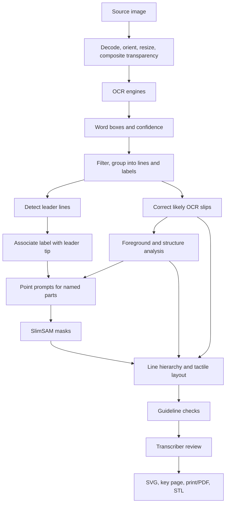

# Architecture and design theory

## The problem TouchSight-NG is designed to solve

A printed diagram is designed for vision. It communicates through colour, shading, fine lines, spatial proximity, typography, and visual conventions that do not transfer directly to touch. A tactile graphic must be a deliberate reinterpretation rather than a literal tracing.

A useful tactile transcription has to answer several questions: What text is present? What does each label refer to? Which shapes carry meaning? How should visual information be encoded for touch? How can the result be checked?

TouchSight-NG is organized around those questions. It attempts to create a reviewable first draft, not an autonomous final transcription.

## Browser-only architecture

The application is a static browser application. There is no application backend or image-upload service. Image decoding, OCR, leader analysis, segmentation, tactile layout, checking, SVG rendering, and 3D preview execute on the user's device.

This architecture is intentional:

- **Privacy:** source diagrams are processed locally rather than uploaded to an application server.
- **Cost control:** inference does not require a paid hosted inference API.
- **Deployment simplicity:** the app can be served as static files from a local development server.
- **Hardware reach:** the current implementation favors WebAssembly inference on ordinary CPU hardware over a GPU-only requirement.

GitHub Pages hosts the MkDocs documentation only. It does not host the application. See [Documentation deployment](deployment.md).

## Conceptual processing architecture



The diagram shows conceptual dependencies. OCR, line analysis, and foreground analysis share the prepared source image; segmentation uses label anchors and an image embedding; layout consumes the analysis records.

## Why labels drive the geometry

Generic edge detection answers “where does contrast change?” It does not answer “which boundaries describe a named scientific part?” A textbook diagram may contain text, stipple, gradients, arrows, borders, and decorative marks. A naive edge detector can turn all of these into raised clutter.

TouchSight-NG uses labels as semantic anchors:

- OCR proposes label text and a bounding box.
- Leader analysis attempts to find the line connecting the label to a part.
- The leader endpoint becomes a point prompt for segmentation.
- A label printed directly on a part can instead use nearby in-figure points.
- The segmentation mask helps identify which boundaries should receive stronger tactile emphasis.

This is a hybrid system: learned models handle text recognition and part segmentation; deterministic image processing handles geometric masks, leader-line chaining, contour extraction, and layout constraints.

## Runtime engines and downloaded assets

| Component | Role | Runtime |
|---|---|---|
| OpenCV.js | Image operations, morphology, Hough line detection, contours, masks, checks | WebAssembly / JavaScript |
| PaddleOCR detector + recognizer | Primary printed-text detection and recognition | ONNX Runtime Web, WASM |
| Indra OCR det + rec (opt-in) | Experimental alternative printed-text engine, Latin script | ONNX Runtime Web, WASM |
| Tesseract.js + English traineddata | Fallback OCR when PaddleOCR cannot load or run | WebAssembly |
| SlimSAM | Point-prompted segmentation of labeled parts | Transformers.js + ONNX Runtime WASM |
| ONNX Runtime Web | Executes OCR and segmentation ONNX models | WebAssembly |
| three.js | Interactive 3D relief preview | WebGL |
| Potrace WASM | Opt-in raster preprocessing through the Autotrace control; its SVG result is rasterized before normal analysis | Locally vendored WebAssembly package |

See [Models and inference engines](models-and-engines.md) for model identities, files, roles, and caveats.

## Source layout

```
src/                browser application source
  index.html        application shell
  css/              application styles
  js/               OCR, leaders, segmentation, layout, rendering, UI
  samples/          sample diagrams and source attributions
  precomputed/      fallback tactile SVGs for selected samples
  fonts/            self-hosted fonts
scripts/            vendor setup, local server, evaluation and QA tooling
docs/               MkDocs documentation (published to GitHub Pages)
```

Generated vendor libraries and model weights are not committed as application source. The repository currently has an incomplete `src/` to `app/` runtime transition: the local server and vendor script target `app/`, while the application source tree is `src/`, and no build/copy step currently populates the served directory. Resolve this before treating a clean checkout as runnable; see [Getting started](getting-started.md#asset-path-check).

## Module map

| Module | Responsibility |
|---|---|
| `src/js/ui.js` | App state, views, review rail, controls, exports, deep links |
| `src/js/pipeline.js` | Orchestrates OCR, leader detection, foreground/line analysis, segmentation |
| `src/js/paddle.js` | PaddleOCR detector and recognizer using ONNX Runtime Web |
| `src/js/ocr.js` | Word filtering, line grouping, multi-line label grouping |
| `src/js/leaders.js` | Thin-stroke masks, probabilistic Hough segments, leader assignment and chaining |
| `src/js/segment.js` | SlimSAM image embeddings and point-prompted masks |
| `src/js/libs.js` | Lazy loaders for OpenCV, Tesseract, Transformers.js, and ONNX Runtime |
| `src/js/lineart.js` | Colour-region boundaries and thin structural strokes |
| `src/js/tactile.js` | Physical page layout, textures, braille placement, clearance |
| `src/js/braille.js` | UEB Grade 1 encoding and two-letter keys |
| `src/js/render.js` | SVG output and preview rendering |
| `src/js/check.js` | Automated geometric checks and edge-tracing baseline |
| `src/js/relief.js` | three.js relief preview and STL export |

## Design trade-offs

- **WASM over mandatory GPU inference:** improves compatibility but constrains model size and speed.
- **Small specialist models over one large multimodal model:** keeps downloads and inference requirements manageable; the trade-off is explicit hand-offs between OCR, geometry, and segmentation.
- **Label-guided segmentation over whole-image segmentation:** narrows the task to named parts, but errors in OCR or leader detection propagate downstream.
- **Physical units over pixel-only layout:** tactile spacing is a physical constraint.
- **Human review over automatic acceptance:** geometric checks cannot establish tactile readability.


## Editable SVG handoff

The rendering stage produces vector artwork with named groups and physical millimetre dimensions. After the automated checks and transcriber review, the SVG can be opened in Inkscape (the recommended FOSS editor) or any SVG-capable editor, including Illustrator or Affinity Designer, for manual path cleanup and production QC. The editor is optional; physical proofing and tactile review remain necessary. See [Review workflow](review-workflow.md).
