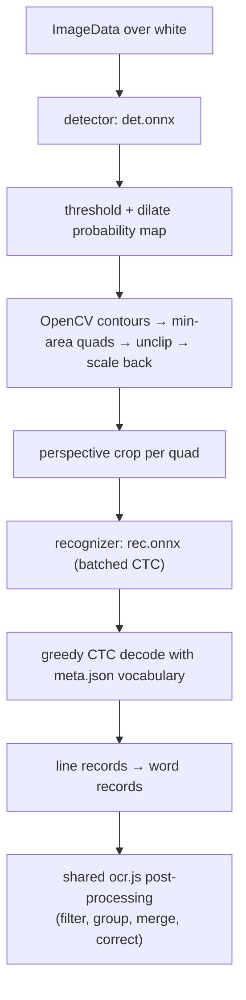

# OCR engines

TouchSight-NG reads the printed labels on a diagram with one of three on-device
OCR engines. They are tried in a fixed order, and the pipeline reports which
one was used (the "ocrEngine" field in the analysis result, also visible in
the browser console as an "OCR engine:" message):

1. **Indra OCR** (Datalab, v1.1.0) - opt-in from the **"Use Indra OCR"**
   checkbox under *Output options*.
2. **PaddleOCR** (PP-OCRv6 det + PP-OCRv5 English rec, RapidOCR's ONNX
   conversions) - the default.
3. **Tesseract.js** - the last resort, used only if PaddleOCR itself
   could not run.

Each stage runs only when the previous one throws or finds no text at all,
so selecting Indra can never leave the pipeline worse than the default chain.

## Using the Indra engine

1. Prepare the model assets once:

   ```bash
   npm ci
   npm run vendor
   ```

   The vendor script downloads the Indra ONNX detector, recognizer, and
   character vocabulary into `src/models/indra/` alongside the other models.
   It is skipped if the files are already present.

2. Start the app (`npm run serve`, open `http://localhost:5173`).
3. Check **Use Indra OCR** under *Output options*. Changing the checkbox
   re-runs the whole analysis. Leave it unchecked to keep PaddleOCR.

Because the engine change only affects label reading, leader detection,
segmentation, layout, checking, and export behave identically either way.

## Architecture of the JavaScript port

The port follows the same engine contract as the PaddleOCR module
(`src/js/paddle.js`): it consumes an `ImageData`, and returns word records
(`text`, `conf`, `x0`, `y0`, `x1`, `y1`, `line`) accepted unchanged by the
shared post-processing in `src/js/ocr.js` (filtering, line grouping, label
merging, vocabulary correction). Downstream stages cannot tell which engine
produced the words.



Roles of the vendored files:

| File | Role | Notes |
|---|---|---|
| `det.onnx` (~390 KB) | DB-style text detection: predicts a probability map of text regions | Post-processed by OpenCV into quadrilateral boxes (threshold, unclip, scale-back) |
| `rec.onnx` (~5 MB) | Latin script recognizer: CTC-style character sequence over a cropped text line | Run batched over all crops of the image |
| `meta.json` (~212 KB) | Character vocabulary (and, for the Python package, decoding metadata) | The JS port reads only the vocabulary and the optional blank index |

Everything runs on onnxruntime-web (WASM execution provider) using the same
vendored bundle that SlimSAM and PaddleOCR use. No Python, no server, and no
network access at run time: the checkbox only changes which locally stored
ONNX files are loaded into the same pipeline.

### Where the port is deliberately conservative

The Python reference implementation (`pip install indra-ocr`) includes
components this port does not use, because they were ambiguous from the model
artifacts alone or clearly out of scope for a first integration:

- **Input shape probing.** The recognizer's expected tensor shape is not
  documented in the model repository, so `src/js/indra.js` probes a small
  set of candidate `(batch, 3, H, W)` shapes once at load time and caches
  the winner. If probing fails, the engine throws and the chain falls back.
- **Channel order.** Whether the detector was trained on RGB or BGR input
  cannot be read from the ONNX file. The choice is a named constant
  (`DET_BGR`) with instructions, not a silent guess.
- **Vocabulary parsing.** `meta.json` is written for the Python package;
  the loader accepts several plausible vocabulary layouts and fails loudly
  rather than decoding garbage.
- **Not ported:** the multi-script recognizers (`rec_cjk.onnx`,
  `rec_rtl.onnx`, `rec_world.onnx`), language-model rescoring
  (`lm.npz`), and the orientation and script classifiers
  (`orient.onnx`, `script.onnx`). Tilted pages, handwriting-heavy pages,
  and non-Latin scripts are better served by the default chain or the
  Python package; the fallback exists for exactly this reason.

Because of these omissions the checkbox is opt-in and off by default, and the
result is treated as experimental until the validation below passes.

## Validation methodology

Before relying on the checkbox for real transcription work:

1. Run the sample diagrams through the reference implementation:

   ```bash
   pip install indra-ocr          # reference, pinned to a known version
   indra-ocr src/samples/heart.png --format json
   ```

2. Run the same diagram in the app with "Use Indra OCR" checked, and open
   the **What the AI saw** tab. Compare per-line text and boxes with the
   reference JSON.
3. discrepancies in *boxes* usually indicate the DB post-processing
   constants; discrepancies in *text* usually indicate the recognizer
   normalization, shape probing, or vocabulary. The console timing record
   (`detectTextIndra.lastTiming`) reports detector and recognizer phases.
4. The evaluation harness (`npm run eval`, Playwright) records
   `window.__touchsight.analysis.ocrEngine`, so an engine-comparison run of
   the full benchmark is a small addition to `scripts/eval.mjs` and the
   right way to decide whether Indra measurably improves label recall on
   the samples before making it the default.

## Licensing and redistribution

The models are downloaded from Datalab's official Hugging Face repository
([datalab-to/indra-ocr](https://huggingface.co/datalab-to/indra-ocr)), pinned
to the v1.1.0 commit, with the repository LICENSE copied alongside
(`src/models/indra/LICENSE`). As with the other model assets, confirm that
the license keeps the weights redistributable in this GPL-3.0 project (and in
any derived distribution) before shipping builds that include them. If it
does not, delete the `src/models/indra/` folder and uncheck the box: the
engine chain degrades gracefully to PaddleOCR, then Tesseract.

## Related pages

- [Models and inference engines](models-and-engines.md) for the full model
  inventory and the PaddleOCR/Tesseract details.
- [Pipeline stages](pipeline.md) for what happens to the words after OCR.
- [Evaluation and benchmarks](evaluation.md) for the harness used to compare
  engines.
