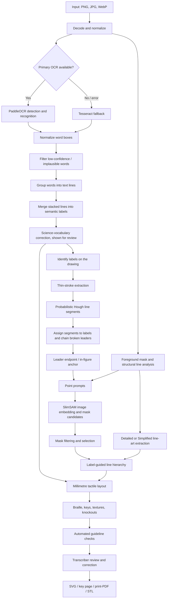
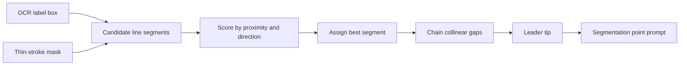

# Pipeline stages and theory

TouchSight-NG is a hybrid computer-vision pipeline. OCR and segmentation use trained neural networks; OpenCV operations and project-specific algorithms connect their results and convert them into tactile geometry.

## End-to-end pipeline

## 1. Input normalization

The UI accepts PNG, JPEG/JPG, and WebP. It rejects files over 15 MB and scales the longest image side to at most 1,400 pixels before analysis. The image is drawn over a white canvas, so transparent pixels are composited onto white. This bounds memory and inference time while retaining detail for common textbook diagrams.

The original image is retained in the UI for comparison. Analysis operates on the normalized raster.

## 2. OCR: find printed labels

### PaddleOCR is primary

The pipeline attempts PaddleOCR first. Its two ONNX models have separate jobs:

- **Text detector:** PP-OCRv6 detection-small predicts regions likely to contain text. The implementation uses a DB-style detector and post-processes probability maps into candidate text boxes.
- **English recognizer:** PP-OCRv5 English recognition-mobile reads cropped text regions. It uses a CTC-style character sequence output and the character dictionary embedded in the ONNX model metadata.

The app loads both models through ONNX Runtime Web using the WASM execution provider. The detector proposes line/region boxes; recognition reads the crops. The current implementation normalizes recognized lines into approximate word boxes based on character counts. Those boxes are regrouped by the general OCR code.

### Tesseract is the fallback

If PaddleOCR cannot load or throws during recognition, the pipeline falls back to Tesseract.js. It uses English traineddata, LSTM-only OCR engine mode (OEM 1), and page segmentation mode 11 (sparse text), suitable for scattered diagram labels rather than full paragraphs.

The fallback makes a second pass on an adaptive-threshold/binarized image and merges overlapping word boxes, retaining the more confident recognition. This can recover text that is difficult to read against a coloured fill.

### OCR post-processing

Word boxes are filtered using confidence and geometry rules. Nearby words on a shared baseline become lines. Stacked lines may be merged into one multi-line label unless separate leaders indicate that they are separate labels. Science-vocabulary corrections can repair likely slips; the UI exposes corrections for human review.

OCR does not establish whether a label is scientifically correct or whether it points to the intended part. Those are later association and review tasks.

## 3. Leader-line detection

Leader lines connect printed labels to diagram parts. They are not the same as the outlines of the parts.

The current method:

1. Converts the image to grayscale.
2. Uses morphological black-hat and top-hat operations to highlight thin dark-on-light and light-on-dark strokes.
3. Removes OCR text boxes from this mask so letters are less likely to be mistaken for leaders.
4. Uses probabilistic Hough transform to propose straight line segments.
5. Scores candidate segments by distance from a label, direction away from the label, and length.
6. Chains nearby, approximately collinear segments to reconstruct broken or dotted leaders.
7. Uses the far endpoint as an approximate point on the named part.

This is a geometric heuristic, not a learned relationship model. Crossings, arrowheads, curved leaders, or crowded diagrams can produce incorrect endpoints. The review overlay is important.

## 4. Foreground and structural line analysis

The foreground stage estimates which pixels belong to the diagram rather than the page background. The implementation estimates a background colour from border pixels, thresholds colour distance, removes text boxes, applies morphological opening/closing, fills holes, and removes small components.

The structural line stage is separate from leader detection. It seeks meaningful internal boundaries:

- Smooths and downsamples the image.
- Converts colour to Lab space.
- Clusters drawing colours with k-means.
- Merges small regions into neighbouring regions to suppress shading speckle.
- Extracts boundaries between colour regions when there is a real colour step.
- Includes thin drawn strokes that are darker or more saturated than their surroundings.
- Excludes text and short decorative marks where possible.

Leader lines communicate label-to-part relationships; structural lines describe the parts themselves.

## 5. Segment named parts with SlimSAM

SlimSAM is a compact, distilled Segment Anything model. The app computes an image embedding once, then uses point prompts derived from leader tips or points near labels printed inside the drawing.

For each prompt, the model returns multiple candidate masks and confidence scores. The code rejects masks outside configured area fractions. Among candidates whose score is within 0.06 of the best score, it prefers the smaller mask because a label is more likely to name a specific component than an entire surrounding object. The selected mask is intersected with a dilated foreground mask so it does not expand into the page background.

This heuristic constrains a general-purpose segmentation model to diagram parts, but it does not guarantee semantic correctness.

## 6. Convert visual structure to tactile structure

Two line-art styles are available:

- **Detailed:** retains more of the source drawing's structure. Text and leader lines are removed from the figure tracing where possible. Boundaries associated with named-part masks receive stronger emphasis.
- **Simplified:** emphasizes boundaries between flat colour regions and thin drawn strokes while suppressing shading and small specks. Nearby lines are merged/thinned more aggressively.

The tracing sensitivity control changes contour/foreground recovery. It does not disable the tactile layout's physical checks.

## 7. Lay out braille and textures

The layout engine works in millimetres for the selected page size. It places uncontracted UEB Grade 1 braille, optional two-letter keys, and up to five textures. It applies line hierarchy, texture insets, braille clearance, and knockouts. See [Tactile layout and BANA guidelines](guidelines.md).

## 8. Check and review

The checker measures selected geometric properties such as short fragments, narrow gaps, and braille clearance. It also compares the output with a Canny edge-tracing baseline. These are diagnostics, not a pass/fail determination of tactile usability.

The transcriber must compare every label and part relationship against the source, inspect the tactile graphic and 3D relief, and perform applicable production QA. See [Review workflow](review-workflow.md).

## Potrace: planned optional preprocessing, not yet active in this main-branch pipeline

Potrace is a bitmap-to-vector tracing engine. The project has an `esm-potrace-wasm` dependency associated with the separate Autotrace work in [PR #4](https://github.com/mrhunsaker/touchsight-NG/pull/4). The current `src/js/pipeline.js` does not import or invoke a Potrace preprocessing stage, and the current `scripts/vendor.mjs` does not copy a Potrace browser bundle into the app's runtime assets.

The intended design under evaluation is to use Potrace as an optional first-pass reconstruction/cleanup step, rasterize its result for downstream analysis, and then run OCR, leader detection, foreground analysis, and segmentation on that prepared image. That differs from replacing the tactile renderer with a Potrace SVG. Treat this stage as planned until PR #4 is merged and the complete browser workflow is verified. See [Models and inference engines](models-and-engines.md#potrace-and-autotrace).
